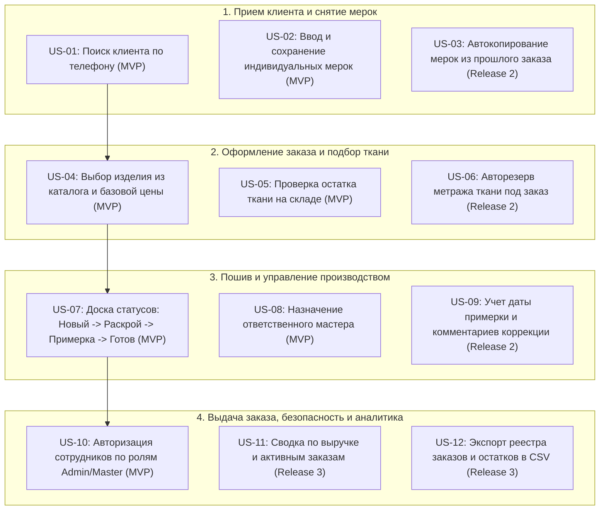

# ЛЗ 4. Стейкхолдеры, Story Map, бэклог и спецификация НФТ

## 1. Матрица стейкхолдеров и план коммуникаций

| Стейкхолдер | Роль | Влияние | Интерес | Стратегия (Матрица) | Что коммуницируем | Канал и частота | Владелец |
| :--- | :--- | :--- | :--- | :--- | :--- | :--- | :--- |
| **Айгуль С.** | Владелица ателье (Спонсор) | Высокое | Высокий | **Управлять тесно (Manage Closely)** | Демо инкремента, статус бюджета/сроков, риски | Очное демо + отчет в Telegram (раз в 2 недели) | PM (`@Forwarde`) |
| **Марат К.** | Старший закройщик | Высокое | Высокий | **Управлять тесно (Manage Closely)** | Удобство формы мерок, списание рулонов ткани, UAT | Прототип в браузере + WhatsApp (еженедельно) | PO/BA (`@Forwardzhemae`) |
| **Администраторы (2 чел.)** | Прием заказов на ресепшене | Среднее | Высокий | **Держать в курсе (Keep Informed)** | Инструкции по заведению заказа и карточки клиента | Видео-гайд + тест на стенде (перед каждым релизом) | PO/BA (`@Forwardzhemae`) |
| **Портные (8 чел.)** | Исполнители пошива | Низкое | Средний | **Держать в курсе (Keep Informed)** | Смена статуса заказа на планшете в цеху | Короткая памятка (1 стр.) на релизе 2.0 | QA / BA |
| **Бухгалтер / Юрист (скрытый стейкхолдер)** | Соответствие Закону РК о ПДн и сверка склада | Высокое | Низкий | **Удовлетворять требования (Keep Satisfied)** | Выгрузка отчетов CSV, согласие клиентов на обработку ПДн | Email / согласование чек-листа (Недели 7 и 11) | PM (`@Forwarde`) |

---

## 2. Выводы из 2 проблемных интервью с пользователями

### Интервью №1 — Айгуль (Владелица ателье, 12 лет опыта)
* **Главные боли:**
  1. «Я узнаю, что дорогая итальянская шерсть закончилась, только когда клиент уже внес предоплату».
  2. «Не вижу в реальном времени, сколько заказов застряло на этапе примерки и кто из мастеров перегружен».
* **Инсайт для продукта:** Нужен автоматический индикатор критического остатка ткани (`< 5 метров`) и дашборд заказов по статусам.

### Интервью №2 — Марат (Старший закройщик, 8 лет опыта)
* **Главные боли:**
  1. «Постоянный клиент приходит через полгода — я трачу 20 минут, чтобы найти его старые мерки (обхват груди, талии, длину рукава) в исписанных блокнотах».
  2. «В цеху руки заняты мелом и ножницами — мне некогда заполнять 30 мелких полей на клавиатуре».
* **Инсайт для продукта:** Карточка клиента должна находиться по номеру телефона за 2 секунды, а прошлогодние мерки должны подтягиваться в новый заказ одной кнопкой «Скопировать мерки».

---

## 3. User Story Map (с выделением среза Walking Skeleton / MVP)

*Все 16 историй перенесены в трекер [GitHub Issues](https://github.com/Forwarde/ecomerce-project/issues) с критериями приемки (Given–When–Then), оценками в Story Points и метками эпиков.*

---

## 4. Спецификация нефункциональных требований (НФТ) — 14 измеримых пунктов

| ID | Категория НФТ | Измеримое требование (Критерий приемки) | Способ проверки |
| :--- | :--- | :--- | :--- |
| **NFR-01** | **Производительность (Latency)** | Время ответа страниц каталога (`/`) и авторизации (`/login`) при 95-м перцентиле (`p95`) не превышает **800–1000 мс** при нагрузке до 10–50 одновременных виртуальных пользователей. | Нагрузочный тест `k6/load-test.js` в GitHub Actions |
| **NFR-02** | **Пропускная способность** | Система обрабатывает не менее **20 RPS (запросов в секунду)** с долей ошибок (`http_req_failed`) менее **1%**. | Отчет `k6-summary.json` |
| **NFR-03** | **Доступность (Availability / SLA)** | Целевая доступность веб-приложения в рабочие часы ателье (09:00–21:00 GMT+5) составляет **≥ 99.5%** (допустимый простой не более 1.8 часа в месяц). | Мониторинг `Uptime Kuma` (интервал пинга 60 сек) |
| **NFR-04** | **Безопасность и разграничение доступа (RBAC)** | Неавторизованный пользователь при обращении к `/admin` перенаправляется на `/login` за `< 100 мс` (через `middleware.ts`); сессия хранится в `HttpOnly` cookie. | Автотест и ручная проверка UAT |
| **NFR-05** | **Защита от уязвимостей зависимостей** | В production-сборке должно быть **0 незакрытых уязвимостей уровня CRITICAL** по базе CVE. | Автоматический скан `Trivy` в `.github/workflows/ci.yml` |
| **NFR-06** | **Надежность и резервное копирование (RPO / RTO)** | **RPO (Recovery Point Objective) ≤ 24 часа** (ежедневный дамп БД в 02:00); **RTO (Recovery Time Objective) ≤ 30 минут** (развертывание из `docker-compose.yml` и восстановление дампа). | Учения по Runbook (ЛЗ 11) |
| **NFR-07** | **Локализация и валюта** | Все денежные суммы отображаются в тенге (**₸ / KZT**), формат дат — `ДД.ММ.ГГГГ` (локаль `ru-KZ` / `kk-KZ`), поддержка кириллицы и казахского алфавита (UTF-8). | Проверка UI в UAT |
| **NFR-08** | **Персональные данные (Закон РК)** | Обрабатываются только ФИО, телефон и мерки клиента; хранение локализовано на сервере в РК; при создании карточки фиксируется отметка о согласии на обработку ПДн согласно Закону РК «О персональных данных и их защите». | Чек-лист соответствия (ЛЗ 7) |
| **NFR-09** | **Аудит и журналирование** | Все операции входа, создания заказа и изменения остатка ткани логируются в stdout/файл контейнера с указанием `timestamp`, `user_role`, `action`, `status_code`. | Проверка `docker compose logs` |
| **NFR-10** | **Масштабируемость и контейнеризация** | Приложение полностью упаковано в Docker-образ; холодный старт контейнера занимает **≤ 15 секунд**, потребление ОЗУ контейнером Next.js в штатном режиме **≤ 512 МБ**. | `docker stats` при запуске стенда |
| **NFR-11** | **Юзабилити и скорость работы оператора** | Оформление нового заказа оператором (выбор клиента + ввод 6 мерок + выбор ткани) требует **не более 8 кликов и ≤ 3 минут**. | Хронометраж на UAT (ЛЗ 11) |
| **NFR-12** | **Адаптивность и кроссбраузерность** | Интерфейс корректно отображается без горизонтальной прокрутки на экранах от **360px** (смартфон мастера в цеху) до **1920px** (ПК администратора) в Chrome, Edge и Safari. | Проверка DevTools Responsive Mode |
| **NFR-13** | **Доступность интерфейса (Accessibility)** | Контрастность текста и кнопок соответствует стандарту **WCAG 2.1 уровень AA** (коэффициент контрастности ≥ 4.5:1), все поля ввода имеют явные `<label>`. | Аудит Lighthouse Accessibility ≥ 90 |
| **NFR-14** | **Интеграция и переносимость данных** | Система обеспечивает импорт/экспорт справочника тканей и заказов в стандартном формате **CSV / JSON (UTF-8)** без потери данных. | Тест экспорта данных |
