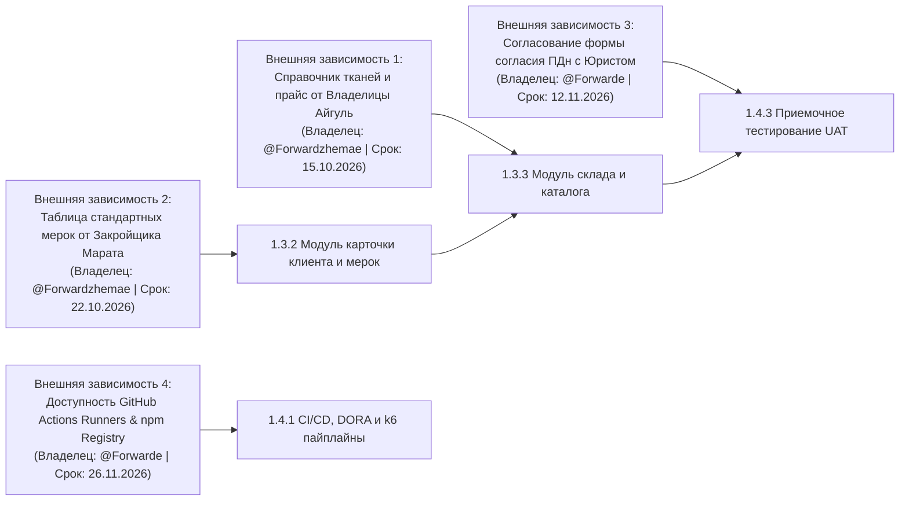

# ЛЗ 5. WBS, план релизов, карта зависимостей, RACI и расчет Capacity

## 1. Иерархическая структура работ (WBS до 3-го уровня)

```mermaid
flowchart TD
    ROOT["1.0 Проект ИС AtelierFlow"]

    ROOT --> W1["1.1 Управление и инициация"]
    W1 --> W11["1.1.1 Бизнес-кейс, TCO/ROI и Устав"]
    W1 --> W12["1.1.2 ADR-001 и настройка GitHub Workspace"]
    W1 --> W13["1.1.3 RAID-лог, SoW, SLA/SLO и FinOps"]

    ROOT --> W2["1.2 Проектирование и требования"]
    W2 --> W21["1.2.1 Проблемные интервью и Story Map"]
    W2 --> W22["1.2.2 Спецификация 14 НФТ и модель угроз STRIDE"]
    W2 --> W23["1.2.3 Дизайн UI/UX и схема данных заказов/мерок"]

    ROOT --> W3["1.3 Разработка функционала (Next.js)"]
    W3 --> W31["1.3.1 Модуль авторизации и RBAC (middleware.ts)"]
    W3 --> W32["1.3.2 Каталог изделий, карточка клиента и мерки"]
    W3 --> W33["1.3.3 Доска заказов и складской учет тканей (/admin)"]

    ROOT --> W4["1.4 Инженерная эффективность и качество (CI/CD & QA)"]
    W4 --> W41["1.4.1 Пайплайн сборки, линтинга и Trivy (ci.yml)"]
    W4 --> W42["1.4.2 Пайплайн и дашборд метрик DORA (dora.yml)"]
    W4 --> W43["1.4.3 Нагрузочное тестирование k6 (k6.yml) и UAT"]

    ROOT --> W5["1.5 Развертывание и ввод в эксплуатацию"]
    W5 --> W51["1.5.1 Контейнеризация Docker и Uptime Kuma"]
    W5 --> W52["1.5.2 Эксплуатационный Runbook и Postmortem"]
    W5 --> W53["1.5.3 Обучение сотрудников ателье и сдача проекта"]
```

### Словарь WBS (для 5 ключевых пакетов работ)

| Код WBS | Название пакета работ | Описание и результат (Deliverable) | Владелец | Оценка (ч) | Критерий приемки (DoD) |
| :--- | :--- | :--- | :--- | :--- | :--- |
| **1.1.1** | Бизнес-кейс, TCO/ROI и Устав | Расчет трехлетней стоимости владения, окупаемости и утверждение границ проекта со спонсором | `@Forwarde` | 12 ч | Файлы `lab03-business-case-charter.md` и `lab03-tco-roi.csv` утверждены, все источники цен указаны |
| **1.3.1** | Модуль авторизации и RBAC | Реализация входа `/login`, серверных экшенов и защиты маршрута `/admin` через `middleware.ts` | `@Forwardzhemae` | 18 ч | Неавторизованный запрос на `/admin` редиректится на `/login`, линтер и сборка проходят без ошибок |
| **1.3.3** | Доска заказов и склад тканей | Интерфейс управления заказами, мерками клиентов и остатками рулонов ткани в панели `/admin` | Команда разработки | 32 ч | Создание заказа, смена статуса и контроль остатка ткани работают без ошибок |
| **1.4.2** | Пайплайн и дашборд DORA | Автоматический сбор Deployment Frequency, Lead Time, CFR и MTTR через GitHub Actions и Python API | `@Forwarde` | 14 ч | Воркфлоу `.github/workflows/dora.yml` зеленый, генерирует таблицу в Summary и артефакт `dora-report.md` |
| **1.4.3** | Нагрузочное тестирование k6 и UAT | Скрипт `k6/load-test.js`, воркфлоу `k6.yml` и проведение приемочного тестирования по 8 сценариям | QA / `@Forwarde` | 16 ч | `p95 < 1000 мс` при 10 VUs в CI, подписан протокол UAT по 8 сценариям |

---

## 2. План релизов на семестр (3 инкремента)

| Релиз / Веха | Срок (Неделя) | Цель релиза | Содержание (Срез функциональности) | Критерии готовности вехи (Quality Gate) |
| :--- | :--- | :--- | :--- | :--- |
| **Release 1.0 (Walking Skeleton / MVP)** | **Неделя 5** | Проверить базовый сквозной путь от витрины до входа в систему и автоматизировать сборку | Публичный каталог ателье (`/`), страница входа (`/login`), базовая структура данных, CI-пайплайн (`ci.yml` + `Trivy`) | Сборка `npm run build` и `Trivy` проходят в GitHub Actions; демо витрины принято заказчиком |
| **Release 2.0 (Core Operations & Protection)** | **Неделя 8 (РК-1)** | Автоматизировать работу закройщика и администратора (заказы, мерки, склад тканей) | Защищенная панель `/admin`, создание заказа с индивидуальными мерками, учет остатков тканей, пакет PM-документации недель 1–8 | Защита рубежного контроля №1; все критические баги закрыты; RBAC блокирует неавторизованный доступ |
| **Release 3.0 (Production Ready, DORA & Load Tested)** | **Неделя 11–15 (РК-2)** | Подтвердить выполнение НФТ под нагрузкой, настроить наблюдаемость и передать систему в эксплуатацию | Нагрузочные тесты `k6` в CI, автоматический отчет `DORA`, контейнеризация `docker-compose.yml` с `Uptime Kuma`, UAT, Runbook и Postmortem | Зеленые пайплайны `ci.yml`, `k6.yml`, `dora.yml`; 8 из 8 сценариев UAT пройдены успешно |

---

## 3. Карта зависимостей (включая 4 внешние зависимости)

| № | Внешняя зависимость | Внешний контрагент | Ответственный в команде | Дата подтверждения | План Б при задержке |
| :--- | :--- | :--- | :--- | :--- | :--- |
| **D-01** | Выгрузка актуального прайс-листа услуг и остатков рулонов ткани | Айгуль С. (Владелица ателье) | `@Forwardzhemae` | **15.10.2026 (Неделя 3)** | Загрузка синтетического справочника из 25 типовых тканей с последующим импортом CSV |
| **D-02** | Перечень обязательных размерных признаков (мерок) для верхнего и легкого платья | Марат К. (Старший закройщик) | `@Forwardzhemae` | **22.10.2026 (Неделя 4)** | Использование стандартной размерной сетки ГОСТ/ОСТ с кастомным полем «Примечание мастера» |
| **D-03** | Утверждение текста согласия клиента на обработку ПДн (Закон РК) | Приходящий юрист ателье | `@Forwarde` | **12.11.2026 (Неделя 7)** | Использование типового шаблона согласия по Закону РК «О персональных данных и их защите» |
| **D-04** | Стабильная работа облачных раннеров GitHub Actions и Docker Hub | GitHub / Docker Inc. | `@Forwarde` | **26.11.2026 (Неделя 10)** | Переключение на локальный `self-hosted runner` и локальный запуск `docker compose up` на ноутбуке |

---

## 4. Топология команды и матрица RACI

По классификации **Team Topologies** наша команда из 4 человек организована как единая **Stream-Aligned Team** (команда, выровненная по потоку создания ценности от приема заказа до выдачи изделия), использующая внешнюю платформу GitHub (Actions, Projects) как *Platform-as-a-Service*.

| Артефакт / Процесс | `@Forwarde` (PM / DevOps) | `@Forwardzhemae` (PO / BA) | Участник 3 (Full-Stack Dev) | Участник 4 (QA / SRE) | Спонсор (Айгуль) |
| :--- | :---: | :---: | :---: | :---: | :---: |
| **Устав, Бизнес-кейс, TCO/ROI, SoW** | **R / A** | C | I | I | **C** |
| **Story Map, Бэклог и НФТ** | C | **R / A** | C | C | C |
| **Разработка Next.js приложения (`ITProjects/`)** | C | **A** | **R** | C | I |
| **CI/CD пайплайны (`ci.yml`, `dora.yml`, `k6.yml`)** | **R / A** | I | C | C | I |
| **RAID-лог, STRIDE и тестирование (k6 / UAT)** | **A** | C | C | **R** | C |

---

## 5. Расчет реальной Capacity команды на семестр (15 недель)

* **Состав команды:** 4 студента выпускного курса.
* **Бюджет времени одного студента на проект курса:** 8 часов в неделю (2 ак. ч. ЛЗ + 6 ч. СРС).
* **Валовая мощность (Gross Capacity):** $4 \times 8 \times 15 = 480\text{ человеко-часов}$.
* **Вычеты:**
  - Праздничные дни РК и больничные (5%): **-24 ч**;
  - Рубежные контроли и переключение между предметами (10%): **-48 ч**;
  - Демо, планирование, ретроспективы и поддержка среды (10%): **-48 ч**.
* **Чистая производительная мощность (Net Capacity):** **360 человеко-часов** (из них **54 ч** — буфер 15% в конце релизов, под задачи бэклога распределяется **306 ч**).
