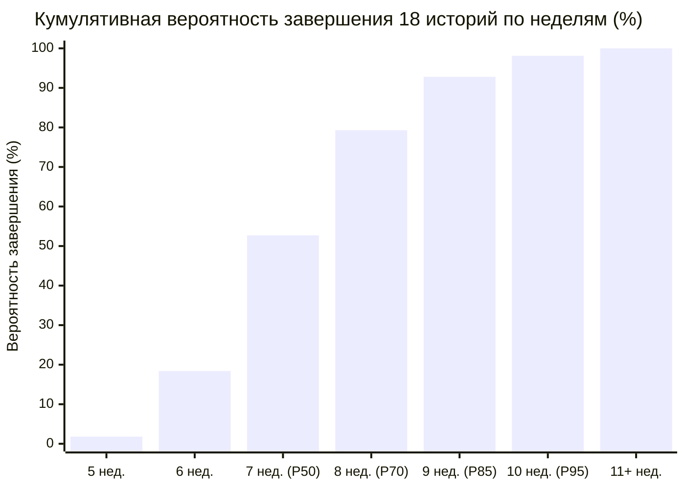

# ЛЗ 6. Вероятностный прогноз сроков (Монте-Карло) и Planning Poker

## 1. Симуляция Монте-Карло (10 000 прогонов)

Воспроизводимый скрипт симуляции находится в [`scripts/monte_carlo.py`](../scripts/monte_carlo.py) (`RANDOM_SEED = 42`).

* **Входные данные:**
  - Исторический throughput команды за 8 недель: `[2, 3, 2, 4, 3, 1, 3, 2]` закрытых историй в неделю (среднее = **2.5 истории/нед.**).
  - Оставшийся объем бэклога: **18 пользовательских историй**.
  - Число прогонов Монте-Карло: **10 000 итераций**.

### Результаты распределения сроков завершения

| Перцентиль (Вероятность завершения в срок) | Прогноз (Недель) | Календарная дата (от 01.10.2026) | Управленческая интерпретация |
| :--- | :---: | :---: | :--- |
| **P50 (Медиана — «бросок монетки»)** | **7 недель** | 19 ноября 2026 | Рискованный внутренний ориентир (50% шанс опоздать) |
| **P70 (Умеренная уверенность)** | **8 недель** | 26 ноября 2026 | Рабочая цель для команды разработки |
| **P85 (Отраслевой стандарт обещания заказчику)** | **9 недель** | **03 декабря 2026** | **Рекомендуемая дата в договоре/плане релиза** |
| **P95 (Консервативный буфер)** | **10 недель** | 10 декабря 2026 | Пессимистичный сценарий с учетом рисков |

### Гистограмма и кумулятивная вероятность (10 000 симуляций)

---

## 2. Сравнение с детерминированной оценкой по Story Points

* **Детерминированный расчет команды по Story Points:**
  - Сумма оценок 18 историй = **54 Story Points**.
  - Оптимистичная плановая велосити команды = **9 SP/нед.**
  - Детерминированный ответ: $54 / 9 = \mathbf{6\text{ недель}}$.
* **Причина расхождения (6 недель по SP против 9 недель по P85 Монте-Карло):**
  1. **Ошибка планирования по лучшему сценарию:** Детерминированная оценка не учитывает недели с просадкой throughput до 1 истории из-за коллоквиумов, багов или ожидания ответов от заказчика.
  2. **Хвост распределения:** По симуляции Монте-Карло вероятность уложиться ровно в 6 недель составляет всего **18.4%**, то есть обещание «сделаем за 6 недель» с вероятностью **81.6% приведет к срыву срока**.

---

## 3. Протокол Planning Poker на 10 историях бэклога

| ID истории | Название истории | Оценки участников (SP) | Итоговая оценка (SP) | Причина разброса мнений при обсуждении |
| :--- | :--- | :---: | :---: | :--- |
| **US-01** | Поиск клиента по номеру телефона | `2, 2, 3, 2` | **2 SP** | Согласие: стандартный фильтр по массиву/БД |
| **US-02** | Форма ввода 12 индивидуальных мерок с валидацией | `3, 5, 5, 3` | **5 SP** | QA напомнил про валидацию диапазонов (см) и мобильную верстку |
| **US-03** | Копирование мерок из предыдущего заказа клиента | `2, 3, 3, 2` | **3 SP** | Небольшой спор о перезаписи измененных полей |
| **US-04** | Витрина каталога изделий с фильтрацией по категориям | `3, 3, 3, 3` | **3 SP** | Единогласно |
| **US-05** | Справочник рулонов ткани с индикатором критического остатка | `3, 5, 2, 5` | **5 SP** | Разработчик оценил в 2 SP, но BA указал на расчет единиц (метры vs рулоны) |
| **US-06** | Авторезервирование метража ткани при создании заказа | `5, 8, 5, 8` | **8 SP** | Высокий разброс: обсудили состояние гонки и возврат ткани при отмене |
| **US-07** | Канбан-доска статусов заказов (`Новый` → `Готов`) | `5, 5, 5, 3` | **5 SP** | Уточнили, что drag-and-drop заменяется быстрыми кнопками смены статуса |
| **US-08** | Назначение ответственного портного и срока примерки | `2, 3, 2, 2` | **2 SP** | Простая привязка к карточке заказа |
| **US-10** | Ролевая авторизация (`middleware.ts` + `/login`) | `3, 5, 5, 5` | **5 SP** | Учли обработку `HttpOnly` cookies и защиту всех роутов `/admin` |
| **US-12** | Экспорт отчета по заказам и остаткам тканей в CSV | `2, 5, 3, 3` | **3 SP** | Разброс из-за кодировки UTF-8 с BOM для корректного открытия в Excel |

---

## 4. Слайд «Когда будет готово» для презентации Заказчику

> ### 📅 Прогноз сроков поставки AtelierFlow (на основе данных потока)
> * **Целевой диапазон готовности полного скоупа (18 историй):** **от 26 ноября до 03 декабря 2026 г. (8–9 недель)**
> * **Уровень надежности прогноза:**
>   - С вероятностью **70%** система будет полностью готова к **26 ноября (8 недель)**;
>   - С вероятностью **85% (наше обязательство по SLA)** — не позднее **03 декабря (9 недель)**.
> * **Ключевые допущения прогноза:**
>   1. Скоуп зафиксирован на уровне 18 историй (новые запросы идут через правило обмена равнозначной задачи).
>   2. Справочник тканей и таблица мерок переданы заказчиком до Недели 4.
>   3. Команда сохраняет текущий темп поставки (в среднем 2.5 готовые истории в неделю при WIP-лимите ≤ 3).
> * **Дата следующего пересмотра прогноза:** через 2 недели после обновления кривой throughput.
