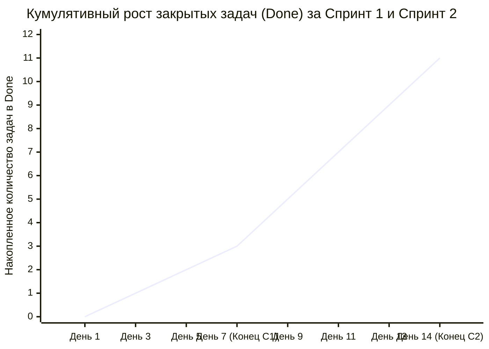

# ЛЗ 9. Симуляция двух спринтов, управление потоком и метрики (WIP, Cycle Time, CFD)

## 1. Настройка рабочего процесса (Kanban / Scrumban политики)

### 1.1. Столбцы доски, WIP-лимиты и явные политики перехода
| Столбец доски | WIP-лимит | Политика входа в столбец |
| :--- | :---: | :--- |
| **1. Backlog** | Без лимита | Задача записана в формате User Story в GitHub Issues |
| **2. Ready (Готово к взятию)** | **≤ 6 задач** | Выполнен чек-лист **DoR (Definition of Ready)** |
| **3. In Progress (Разработка)** | **≤ 3 задачи** | Назначен исполнитель, создана ветка `feature/...` или `fix/...` |
| **4. Code Review & CI** | **≤ 2 задачи** | Открыт Pull Request в `main`, запущены автопроверки `ci.yml` |
| **5. Done (Готово)** | Без лимита | Выполнен чек-лист **DoD (Definition of Done)**, PR влит в `main` |

### 1.2. Определение готовности (DoR) и завершенности (DoD)
* **Definition of Ready (DoR):**
  1. Сформулирована бизнес-ценность истории и критерии приемки (Given–When–Then).
  2. Задача оценена командой (не более 8 SP, иначе декомпозируется).
  3. Нет блокирующих внешних зависимостей (справочники/макеты получены).
* **Definition of Done (DoD):**
  1. Код написан, оформлен PR по правилам [`CONTRIBUTING.md`](../CONTRIBUTING.md) и прошел ревью второго участника.
  2. Пайплайн `.github/workflows/ci.yml` (`npm run lint`, `npm run build`, `Trivy`) прошел со статусом **Success**.
  3. Функционал проверен на локальном стенде `localhost:3000` по критериям приемки.

---

## 2. Спринт 1: Выполнение и выявление узкого места

* **Цель Спринта 1:** Реализовать базовую витрину ателье, модуль авторизации (`middleware.ts`, `/login`), панель администратора (`/admin`) и перенести CI-пайплайн в корень репозитория.
* **Что произошло в Спринте 1:** Команда набирала слишком много задач одновременно (фактический WIP в разработке и ревью доходил до 5 задач), из-за чего Pull Request'ы долго ждали проверки и исправления путей `.github/workflows`.

---

## 3. Протокол ретроспективы после Спринта 1

* **Дата:** Неделя 9. **Участники:** `@Forwarde`, `@Forwardzhemae`, Dev, QA.
* **Что прошло хорошо:** Запустили каркас приложения `ITProjects/` на Next.js 14 и настроили `ci.yml` с проверкой безопасности `Trivy`.
* **Где возникло узкое место (Bottleneck) по CFD:** Задачи скапливались в колонке **Code Review & CI** (время ожидания ревью и починки конфигов CI составляло до 65% от общего Cycle Time).
* **Принятое единственное измеримое действие на Спринт 2:**
  > **Действие:** Ввести жесткий **WIP-лимит = 2** на колонку `Code Review & CI` и правило **«Review First»** (утром перед взятием новой задачи из `Ready` участники обязаны проверить и закрыть висящие PR; SLA на ревью ≤ 12 часов).
  > **Владелец действия:** `@Forwarde` (PM / DevOps).

---

## 4. Сравнение метрик потока: Спринт 1 vs Спринт 2 (по данным репозитория)

После внедрения правила «Review First» и жесткого WIP-лимита во втором спринте были закрыты задачи по Docker-контейнеризации, нагрузочному тестированию `k6`, пайплайну `DORA` и пакету PM-артефактов.

| Метрика потока | Спринт 1 (До ретроспективы) | Спринт 2 (После внедрения WIP-лимита и SLA на ревью) | Изменение и управленческий вывод |
| :--- | :---: | :---: | :--- |
| **Throughput (Пропускная способность)** | **3 задачи / нед.** | **5 задач / нед.** | **+66.7%** (закон Литтла в действии: снижение WIP ускорило выход готовых задач) |
| **Средний Cycle Time (Average)** | **68.0 часов** (2.8 дня) | **29.5 часов** (1.2 дня) | **Сокращение в 2.3 раза** за счет устранения очереди на Code Review |
| **85-й перцентиль Cycle Time (`p85`)** | **104.0 часа** (4.3 дня) | **42.0 часа** (1.75 дня) | **Сокращение в 2.5 раза** — поток стал предсказуемым |
| **Средний WIP (Незавершенная работа)** | **5.2 задачи** | **2.4 задачи** | Снижение переключения контекста между задачами |

### Кумулятивная диаграмма потока (CFD — Cumulative Flow Diagram за 2 спринта)

**Вывод по потоку:** Ограничение незавершенной работы (WIP ≤ 3 в разработке и ≤ 2 на ревью) без увеличения численности команды сократило `p85 Cycle Time` со 104 до 42 часов и ликвидировало пробку на этапе интеграции в ветку `main`.
