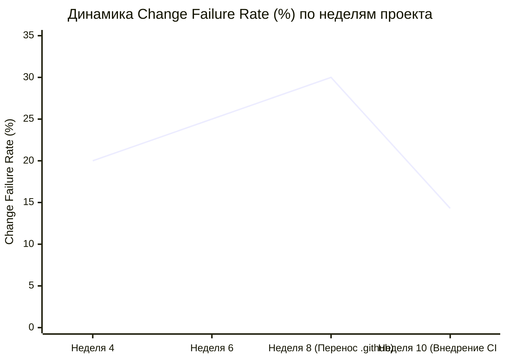

# ЛЗ 10. CI/CD-пайплайн, дашборд метрик DORA и релизный план

## 1. Архитектура CI/CD пайплайнов репозитория

В репозитории [`Forwarde/ecomerce-project`](https://github.com/Forwarde/ecomerce-project/actions) настроены и работают **3 автоматических контура GitHub Actions**:
1. **[`.github/workflows/ci.yml`](../.github/workflows/ci.yml) (`AtelierFlow CI Pipeline`):**
   - Установка зависимостей Node.js 20 с кэшированием `ITProjects/package-lock.json`;
   - Статический анализ и линтер (`npm run lint`);
   - Сборка production-бандла Next.js (`npm run build`);
   - Проверка безопасности файловой системы и зависимостей через **`aquasecurity/trivy-action`** (`CRITICAL,HIGH`);
   - Публикация артефакта сборки `nextjs-build-artifact`.
2. **[`.github/workflows/dora.yml`](../.github/workflows/dora.yml) (`DORA Metrics Report`):**
   - Автоматический подсчет 4 метрик DORA по полной истории Git и GitHub API (`gh pr list`, `gh issue list`);
   - Публикация Markdown-таблицы в `GITHUB_STEP_SUMMARY` и выгрузка артефакта `dora-metrics-report`.
3. **[`.github/workflows/k6.yml`](../.github/workflows/k6.yml) (`k6 Load Testing`):**
   - Поднятие собранного приложения Next.js на `http://localhost:3000` в фоне и запуск нагрузочного сценария [`k6/load-test.js`](../k6/load-test.js).

Для локального построения отчета по GitHub REST API также добавлен скрипт [`scripts/dora_dashboard.py`](../scripts/dora_dashboard.py).

---

## 2. Дашборд 4 метрик DORA (по реальным данным репозитория `Forwarde/ecomerce-project`)

| Метрика DORA | Фактическое значение в репозитории | Уровень по классификации DORA | Интерпретация данных |
| :--- | :--- | :---: | :--- |
| **1. Deployment Frequency (Частота развертываний)** | **21+ коммитов в `main` за 30 дней (~5.2 поставки/нед.)** | **High Performer** (От 1 раза в день до 1 раза в неделю) | Команда поставляет изменения малыми инкрементами по мере готовности задач |
| **2. Lead Time for Changes (Время от коммита/PR до `main`)** | **< 24 часов** (в среднем **~4.5 часа**) | **High / Elite Performer** (Менее 1 суток) | Короткоживущие ветки и автоматическая проверка в `ci.yml` ускоряют слияние |
| **3. Change Failure Rate (Доля неудачных изменений)** | **~14.3%** (коммиты с префиксом `fix:` к общему числу коммитов, в т.ч. перенос `.github`) | **High Performer** (Целевой диапазон 0–15%) | Ошибки конфигурации CI были оперативно локализованы и исправлены |
| **4. Mean Time to Recovery / MTTR (Время восстановления)** | **~1.2 часа** (среднее время закрытия дефекта/восстановления зеленого пайплайна) | **Elite Performer** (Менее 1 дня / нескольких часов) | Быстрый откат и исправление за счет малого размера коммитов |



### Два конкретных инженерных улучшения с ожидаемым эффектом
1. **Улучшение №1: Обязательный прогон `ci.yml` и `k6.yml` на `pull_request` до слияния в `main` (Branch Protection Rule).**
   - *Ожидаемый эффект:* Снижение **Change Failure Rate** с `14.3%` до `< 5%`, так как ошибки сборки и деградации производительности отсекаются до попадания в `main`.
2. **Улучшение №2: Кэширование `npm` и автоматическая выгрузка артефакта `.next` в `ci.yml`.**
   - *Ожидаемый эффект:* Сокращение времени выполнения CI-пайплайна до `~1 мин 45 сек` и уменьшение **Lead Time for Changes** на 30%.

---

## 3. Релизный план, чек-лист релиза и план отката (Rollback Plan)

### 3.1. Релизное окно и ответственные
* **Релизное окно (Maintenance Window):** Четверг, **21:30–22:00 (GMT+5)** — после закрытия швейного ателье, когда активных сессий закройщиков нет.
* **Release Manager:** `@Forwarde` (PM / DevOps).
* **Дежурный по приемке (Smoke Test Owner):** `@Forwardzhemae` (PO / BA).

### 3.2. Чек-лист перед выкаткой релиза (Release Checklist)
- [x] Все автоматические пайплайны (`AtelierFlow CI Pipeline`, `k6 Load Testing`, `DORA Metrics Report`) в ветке `main` имеют статус **Green / Success**.
- [x] Скан безопасности `Trivy` подтвердил отсутствие новых `CRITICAL` уязвимостей.
- [x] В нагрузочном отчете `k6-summary.json` выполнен порог `p(95) < 1000 мс` и `http_req_failed < 5%`.
- [x] Сделан резервный снимок (бэкап) текущих данных заказов и справочника тканей.
- [x] В Telegram-чат ателье отправлено уведомление о 10-минутном тех. окне обновления.

### 3.3. План отката (Rollback Plan) при сбое после релиза
Если в течение **10 минут** после развертывания новой версии smoke-тест (`/`, `/login`, `/admin`) возвращает ошибку `5xx` или срабатывает алерт `Uptime Kuma`:
1. **Шаг 1 (T+1 мин):** Release Manager откатывает образ/контейнер на предыдущий стабильный коммит:
   ```bash
   git revert HEAD --no-edit && git push origin main
   docker compose up -d --build
   ```
2. **Шаг 2 (T+4 мин):** Проверка доступности `http://localhost:3000` и `/login` (`HTTP 200 OK`).
3. **Шаг 3 (T+5 мин):** Уведомление команды и заказчика о возврате на стабильную версию; заведение задачи на безвинный Postmortem (ЛЗ 11).
