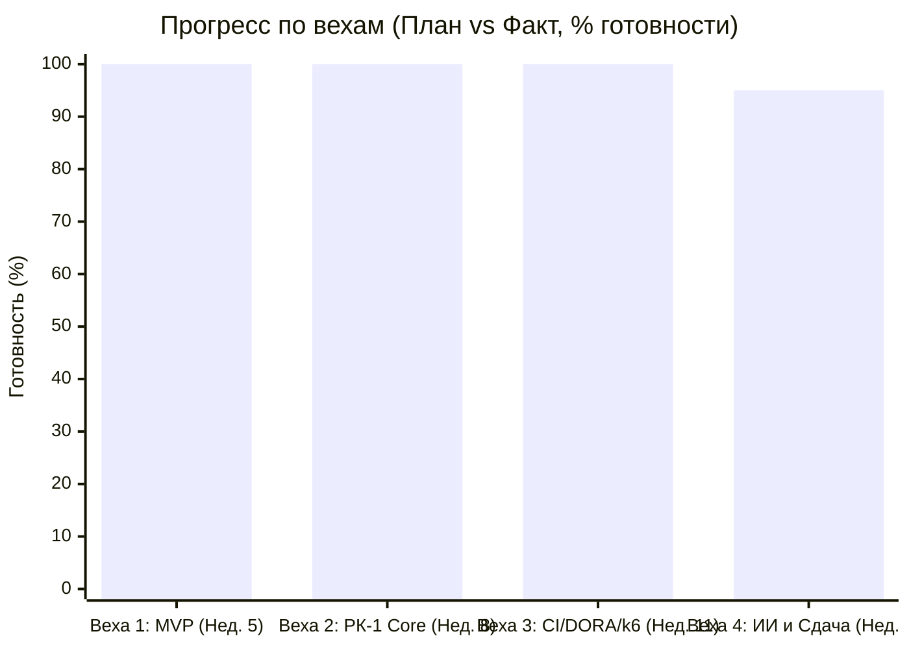

# ЛЗ 14. Приоритизация портфеля (WSJF), дашборд руководителя, статус-отчет и план внедрения изменений

## 1. Приоритизация портфеля из 10 инициатив по методике WSJF

**Формула WSJF (Weighted Shortest Job First):**
$$\text{Cost of Delay (CoD)} = \text{Business Value} + \text{Time Criticality} + \text{Risk Reduction / OE}$$
$$\text{WSJF} = \frac{\text{Cost of Delay}}{\text{Job Size}}$$
*(Оценка по модифицированной шкале Фибоначчи: `1, 2, 3, 5, 8, 13, 20`)*

| Ранг | ID | Инициатива портфеля (AtelierFlow и смежные ИТ-инициативы) | Business Value | Time Criticality | Risk Reduction / OE | **Cost of Delay** | Job Size | **WSJF** | Решение |
| :---: | :---: | :--- | :---: | :---: | :---: | :---: | :---: | :---: | :--- |
| **1** | **IN-01** | **Авторезервирование метража ткани при создании заказа** | 13 | 8 | 13 | **34** | 3 | **11.33** | **В работу немедленно (Топ-1)** |
| **2** | **IN-02** | **Защита `/admin`, аудит ПДн (Закон РК) и гейт `Trivy` + `k6` в CI** | 8 | 13 | 13 | **34** | 3 | **11.33** | **В работу немедленно (Топ-2)** |
| **3** | **IN-03** | **Копирование индивидуальных мерок клиента из прошлого заказа в 1 клик** | 13 | 5 | 3 | **21** | 2 | **10.50** | **В работу немедленно (Топ-3)** |
| **4** | **IN-04** | ИИ-парсер текстовых заявок из WhatsApp (с очисткой ПДн и Human-in-the-Loop) | 8 | 5 | 5 | **18** | 3 | **6.00** | Следующая волна (Release 3.1) |
| **5** | **IN-05** | Экспорт реестра заказов и остатков тканей в CSV/Excel для бухгалтера | 8 | 3 | 3 | **14** | 3 | **4.67** | В бэклог Release 3.1 |
| **6** | **IN-06** | Автоматические уведомления клиенту в Telegram о готовности примерки | 8 | 5 | 2 | **15** | 5 | **3.00** | Отложить на Q2 |
| **7** | **IN-07** | Мультиязычный интерфейс `kk / ru / en` для витрины каталога | 5 | 5 | 3 | **13** | 5 | **2.60** | Отложить на Q2 |
| **8** | **IN-08** | Онлайн-эквайринг (Kaspi Pay / Halyk Epay) прямо на сайте | 13 | 3 | 5 | **21** | 13 | **1.62** | Низкий WSJF из-за большого Job Size |
| **9** | **IN-09** | Двусторонняя интеграция с 1С:Бухгалтерией предприятия | 8 | 2 | 5 | **15** | 13 | **1.15** | Отложить (высокий риск и размер) |
| **10** | **IN-10** | Нативное мобильное приложение iOS/Android для клиентов ателье | 5 | 1 | 1 | **7** | 20 | **0.35** | **Отклонить** (адаптивного веба достаточно) |

### Обоснование Топ-3 инициатив
1. **IN-01 (WSJF = 11.33):** Устраняет главную финансовую утечку бизнеса (~320 000 ₸/мес. потерь ткани) при малом размере реализации (3 балла).
2. **IN-02 (WSJF = 11.33):** Критично по срокам (Time Criticality = 13) и снимает максимальные юридические/киберриски (Закон РК о ПДн + SLA `p95 < 1000 мс`).
3. **IN-03 (WSJF = 10.50):** «Быстрая победа» (Job Size = 2), сокращающая время оформления повторного заказа с 25 до 4 минут и напрямую повышающая принятие системы закройщиками.

---

## 2. Дашборд руководителя (Executive Project Dashboard)

Интерактивная версия дашборда (Streamlit / Python CLI) доступна в скрипте [`scripts/executive_dashboard.py`](../scripts/executive_dashboard.py).

| Блок дашборда | Ключевой показатель (KPI) | План | Факт | Светофор |
| :--- | :--- | :---: | :---: | :---: |
| **Вехи и сроки** | Завершение 3 инкрементов и артефактов портфолио | Неделя 15 | Неделя 14–15 (95% готово) | 🟢 **GREEN** |
| **Метрики потока** | `p85 Cycle Time` / `Throughput` | ≤ 48 ч / ≥ 4 зад./нед. | **42 ч** / **5 зад./нед.** | 🟢 **GREEN** |
| **Метрики DORA** | Deploy Freq / Lead Time / CFR / MTTR | High Performer | 5.2/нед. / 4.5 ч / 14.3% / 1.2 ч | 🟢 **GREEN** |
| **Бюджет (CAPEX + OPEX)** | Прямые затраты на лицензии и инфраструктуру | ≤ 120 000 ₸/год | **0 ₸ лицензии** / 10 000 ₸/мес. VPS | 🟢 **GREEN** |
| **Качество и НФТ** | `k6 p95` и уязвимости `Trivy` | `< 1000 мс` / `0 CRITICAL` | **Зеленый `k6.yml`** / `0 CRITICAL` | 🟢 **GREEN** |
| **Риски и зависимости** | Открытый `PR #6` (Docker) и 14 старых Issues | 0 старых PR > 2 дн. | 1 PR открыт, 14 Issues к чистке | 🟡 **AMBER** |

---

## 3. Статус-отчет на одну страницу (1-Page Executive Status Report)

* **Проект:** AtelierFlow (ИС швейного ателье) | **Период:** Недели 10–14 (Ноябрь 2026) | **Общий статус:** 🟢 **GREEN** (с локальным 🟡 **AMBER** по гигиене бэклога)
* **Критерии светофора:** 🟢 Green — отклонение срока/бюджета < 5%; 🟡 Amber — риск сдвига 1–2 нед. или незакрытый блокер; 🔴 Red — срыв вехи > 2 нед. или падение критического НФТ.
* **Главные достижения периода:**
  1. Запущены и прошли зеленым статусом все 4 автоматических пайплайна GitHub Actions (`ci.yml`, `k6.yml`, `dora.yml`, `pm-assistant.yml`).
  2. Проведены 8 из 8 сценариев приемочного тестирования UAT (`100% PASSED`).
  3. Проведен eval-замер ИИ-парсера заявок на 30 примерах (`90% accuracy`, `0` галлюцинаций цифр, оформлен `ADR-002`).
* **Топ-2 риска и меры:**
  1. *Незакрытые старые Issues и `PR #6`* → Влитие/закрытие до финальной защиты (Владелец: `@Forwarde`, срок: 3 дня).
  2. *Сопротивление портных при переходе с бумаги* → Проведение 2 практических сессий обучения по Плану изменений (Владелец: `@Forwardzhemae`).
* **Решения, требуемые от Спонсора:** Утвердить переход к пилотной эксплуатации на 2 филиалах с 05.12.2026 и согласовать приоритет Топ-3 инициатив WSJF на следующую фазу.

---

## 4. Ролевая игра: Разговор со Спонсором о срыве срока на 4 недели (3 варианта решения с цифрами)

**Ситуация (Правило «никаких сюрпризов»):** За 5 недель до дедлайна выяснилось, что из-за сложности интеграции склада и дополнительных требований по аналитике полный скоуп не успевает к дате — прогноз по Монте-Карло (`P85`) показывает **сдвиг на +4 недели**.

Вместо оправданий PM выносит Спонсору **3 просчитанных варианта решения**:

| Параметр | Вариант А: Срез скоупа до чистого MVP *(Рекомендуется PM)* | Вариант Б: Сдвиг даты запуска на +4 недели | Вариант В: Усиление команды (Capped T&M +1 разработчик) |
| :--- | :--- | :--- | :--- |
| **Срок запуска в прод** | **Точно в срок (0 недель сдвига)** | **+4 недели** (потеря 1 месяца экономии = **-420 000 ₸** Cost of Delay) | **+1 неделя** (на онбординг и синхронизацию) |
| **Бюджет (доп. расходы)** | **+0 ₸** (в рамках текущего бюджета) | **+40 000 ₸** (1 мес. продления поддержки/инфры) | **+280 000 ₸** (70 часов привлеченного разработчика × 4 000 ₸) |
| **Что входит в скоуп** | **100% ядра MVP** (заказы, мерки, склад, RBAC, `k6`); перенос ИИ-парсера и CSV-экспорта в Release 3.1 через 3 недели после старта | **100% полного скоупа** одним релизом | **100% полного скоупа** (с повышенным риском дефектов из-за закона Брукса) |
| **Финансовый итог (Net Impact)** | **Лучший ROI:** ателье начинает экономить 420 000 ₸/мес. сразу без задержки | Прямая упущенная выгода **460 000 ₸** | Перерасход CAPEX на **+280 000 ₸** при умеренном риске качества |

**Рекомендация PM Спонсору:** Утвердить **Вариант А** — запустить стабильное ядро MVP в срок, начать получать экономический эффект от учета тканей уже в этом месяце, а второстепенные функции выпустить вторым релизом через 3 недели.

---

## 5. План управления изменениями (Change Management Plan) при внедрении в ателье

Чтобы система не осталась «на полке», внедрение проходит по 4 шагам (модель **ADKAR**):
1. **Неделя 1 (Коммуникация и «Чемпион изменений»):** Назначение старшего закройщика Марата внутренним амбассадором системы; короткая презентация владелицей ателье (15 мин) с акцентом *«система убирает рутину поиска мерок, а не следит за мастерами»*.
2. **Неделя 2 (Практическое обучение на песочнице):** 2 очных воркшопа по 45 минут (отдельно для администраторов и закройщиков) на тестовых заказах + ламинированная памятка на 1 страницу возле рабочего планшета.
3. **Недели 3–4 (Параллельная эксплуатация и «Hypercare»):** 14 дней новые заказы ведутся в AtelierFlow с дублированием ключевых итогов; ежедневный 10-минутный разбор неудобств в Telegram-чате и оперативные UI-правки в течение 24 часов.
4. **Неделя 5 (Отказ от бумажных журналов и замер выгод):** Закрытие бумажного журнала заказов, первый официальный замер **Benefits Realization** (время оформления заказа до/после и остатки ткани на складе).
